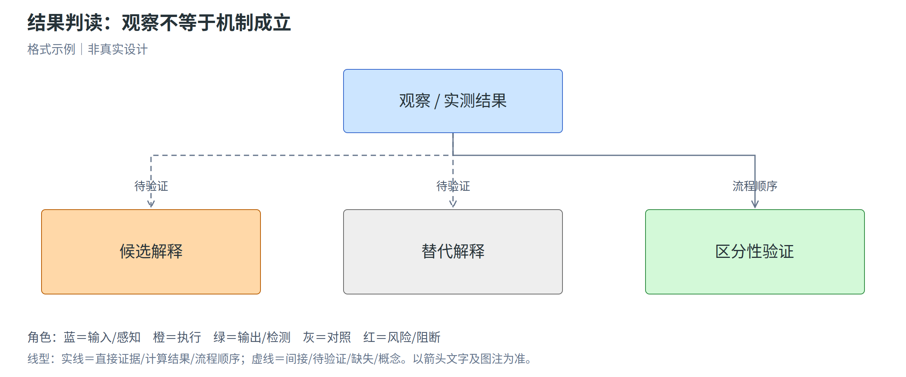
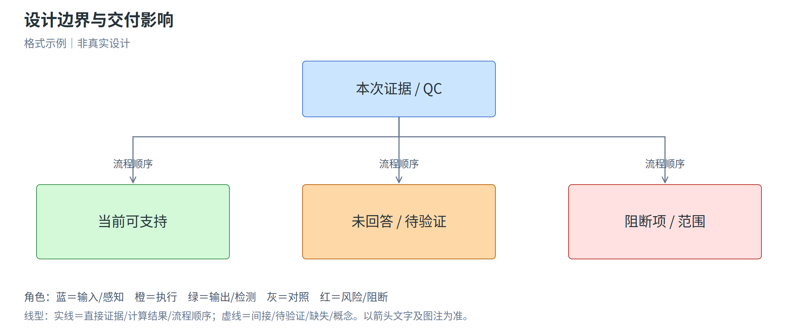

# 植物表达载体设计报告

## 直接结论

基准论文/构建、复刻等级、当前状态、推荐骨架与阻断项。区分原复刻版、必要适配版和优化候选；概述最重要的设计边界，不能只写推荐结论。

## 核心设计思想与总体系统

用简短文字解释本次生物学问题、保真或适配理由，以及输入、执行、输出之间已证实和待验证的关系。本模板附图仅为格式示例，不是真实设计；项目必须重新生成并替换。

图1｜总体系统。填写读图结论、角色/线型图例、每条关键关系的实际证据和原始URL。概念图非比例、坐标未定，不代替序列图谱，也不将预期表型写成实测。

## 文献与序列证据

关键论文信息、支持的实际实验、直接/间接证据、附件位置、NCBI/质粒库记录、版本、哈希与边界。说明已检索范围、访问失败和未解决冲突；每项来源使用原始 URL。

## 表达框与设计决策

逐个列启动子、UTR、intron、CDS/标签/定位、终止区域、方向与调控依赖。说明 intron 和密码子版本是否保真，所有非原始改动及依据。

图2｜表达模块。按实际模块数增删子图，逐个解释目的、结构、来源、功能与待验证点；不得为套模板强凑模块。具体坐标和长度只由实际序列注释流程生成。

## 机制与植物体内工作模式

图3｜工作模式。说明组织/阶段和过程层级，并逐条区分直接、间接、计算、待验证或缺失证据。非代谢项目不强行套通路，流程顺序不能冒充因果证据；图注给真实原始URL或项目记录。

## 骨架与构建策略

原骨架/库存兼容矩阵，选定路线、片段来源、中间体、接口、验证点、对照与备选。

图4｜构建与整合路线。按实际的瞬时、稳定或遗传组合需求绘制，标中间体和检查点。图示来源、接口依据和未知项写在图注，不将并行输入画成无依据的串联调控。

## 文献驱动的R01–R12设计审查

附本项目design-review.tsv，逐项写审查状态、体系、证据、限制、后续动作及阻断范围。重点说明精确leader/3′区域、元件组合、邻接框与内参、多基因机制、语法/骨架兼容及RNA/蛋白加工，而不只比较启动子名称或模型总分。

## 分阶段验证与实施流程

图5｜分阶段验证。按问题区分质粒结构、RNA、蛋白/加工、功能及适用的稳定插入/遗传层级。每层的前置条件和回退另记，不预设统一事件数、固定表达倍数或成功率。

| 阶段 | 要回答的问题和读数 | 关键对照 | 进入下一阶段的依据 | 失败与回退 |
|---|---|---|---|---|
| 待填写 | 待填写 | 排除哪种替代解释 | 有依据判据，未知则注明 | 指明先查哪一层 |

## 观察窗口与结果判读

说明时期、组织/位置、检测条件及内参是否有足够依据；采样数、曝光和阈值未确定时写NA，不照抄样例参数。

图6｜观察→可能解释→替代解释→最小验证。填项目特异的判读和来源；有信号不等于完整功能，无信号不自动归因于启动子，未执行不填结果。

## 标签决策与文献推荐

逐个新设计的表达产物记录是否已询问标签需求及用户原始决定；待回答不能假定为无标签。复刻只记录原标签和来源，改变标签必须另列为适配。

用户需要标签时再按实际目标检索文献，比较少量候选，不输出通用“最佳标签”清单。推荐必须指明标签精确版本/拷贝、融合位置、连接肽、终止密码子处理、序列来源和确认状态；支持的是哪项实验读数，而非仅有荧光或抗体信号。

新增融合必须给出从 N 到 C 的最终蛋白架构。C 端标签、N 端标签和内部插入分别审计上游片段是否带 stop；按真实序列注明删除、原本没有或作为最终 stop 保留，不能只写“已去 stop”。目标与标签之间的柔性连接肽必须列出肽段、DNA、长度、文献/设计依据及独立注释，并核对接头、读框和全融合翻译。

| 目标CDS与用途 | 是否加标签及用户依据 | 候选标签/版本 | 文献系统及支持实验 | 推荐位置/连接与理由 | 风险、对照与不选理由 | 序列来源及确认状态 |
|---|---|---|---|---|---|---|
| 待填写 | 用户明确决定或待询问 | 不添加则写不适用 | 标题、DOI/原始URL、物种/体系、支持结果与限制 | 未确认则保留草案 | 无标签/替代位置等适用对照及功能验证 | 未获得精确序列不得进入最终版 |

未检索到足够直接证据时，标为间接证据/待验证候选；没有证据不能靠 Evo2 单独选择标签。用户不添加时，不为满足表格而硬推荐标签或改成报告基因融合。

### 融合接头与终止密码子审计

新增融合时填写下表，并附最终 N 到 C 顺序、连接肽 DNA/肽段/长度和两侧接头窗口。未新增标签则写不适用；原样复刻未做逐来源审计时明确标未执行，不能伪称通过。

| 组件/接头 | 来源坐标与方向 | 来源末端stop是否存在 | 实际处理与理由 | 最终片段/接头及连接肽 | 读框与翻译检查 | 依据及未验证影响 |
|---|---|---|---|---|---|---|
| 待填写 | 指明 source_id 和实际坐标 | 具体三联体或原本无stop | 删除/原本没有/仅作为最终stop保留 | 给真实序列或可核验文件位置 | 不填未执行的通过结果 | 柔性与功能效果仍按证据分层 |

最终 stop 单独注明 codon、来源模块/骨架/新设计及准确坐标。接头窗口应说明使用剪接后编码坐标还是质粒坐标，不能混用；克隆留下的残基和信号元件也计入完整预期融合蛋白。

## 序列检查与图谱

实际输出文件、长度、注释、翻译、保护区、位点、跨文件一致性；未执行检查标 NA。

有真实GenBank时附只读sequence_review结果，明确ATG-only与精确重复的局限；缺注释是未评估，不是没有问题。把实际plasmid_map.svg和expression_map.svg嵌入项目正文，检查文件确已生成；概念图不认证真实载体。

## Evo2 评估与优化

执行/未执行、实际模型/版本、运行时权重配置、输入与协议、原始评分和差值、QC/可比性、校准限制。没有数据不得填示例分数；不将模型偏好写成表达提升。

## 设计边界与未解决问题

以下三个小节为必填，不得用一句“需进一步验证”代替。区分已证实缺点、设计取舍、待验证风险和信息缺失；空白或占位不能作为正式报告。

### 适用范围与不能保证的结论

明确本次物种/基因型、组织/阶段、表达与转化体系、用途、构建版本及复刻等级。对每项主要结论写出适用依据及禁止外推的范围，并分开列计算、实物与功能验证状态。

图7｜证据边界。分开显示当前可支持、待验证/缺失和阻断项；每项对应实际来源，颜色仅表示角色，不表示证据强弱。未验证的组合、RNA加工、蛋白完整性或稳定插入不得从序列检查外推。

- 本次证据和计算可以支持什么：
- 本次设计不能保证什么，为什么：
- 尚未覆盖的宿主/组织/条件或评价终点：
- 序列复刻与原报道功能能否复现之间，尚缺哪些直接证据：

### 已知缺点与设计权衡

只将有依据的不足写为已知缺点。潜在问题明确标为待验证风险；受现有骨架、保真要求或构建成本限制所作选择写为设计权衡。

| 编号 | 元件/对象及具体问题 | 性质与证据状态 | 依据/来源 | 影响及适用条件 | 严重度及理由 | 当前处理与残余限制 |
|---|---|---|---|---|---|---|
| 待填写 | 待填写 | 已证实缺点/设计权衡/待验证风险 | 原始URL、实际文件/结果记录，或明确暂无直接证据 | 待填写 | 不编造发生概率 | 待填写 |

如未找到直接证据支持的已知缺点，写明检索/检查范围及仍未评估的事项，不能得出“没有缺点”。

### 当前无法回答的问题

逐项说明为什么无法回答：资料或序列缺失、版本歧义、未执行测试、模型能力不覆盖、缺少特定条件实验，或超出本任务范围。写清该未知是否影响当前选择，是否阻断对应交付。

| 问题编号 | 本次无法回答的具体问题 | 无法回答原因/缺失证据 | 对本次决策的影响 | 需要的资料或最小验证 | 可判定结果/终点 | 是否阻断交付及范围 |
|---|---|---|---|---|---|---|
| 待填写 | 待填写 | 待填写，不以“系统复杂”敷衍 | 待填写 | 待填写 | 需要观察到什么才能回答 | 序列导出/模型结论/功能外推分别判断 |

影响完整序列、原版身份或关键组装结构的未解决项，必须同步写入构建清单 `unresolved_issues`。功能未知不自动否定计算设计，但必须限制功能宣称；未执行的 Evo2 不得补出分数。

## 待优化方向与验证计划

保留原报道复刻版，只在明确目标、证据缺口或用户许可区域提出优化候选。按优先级列少量可执行方向，不为“优化”而改写已经有直接证据的设计。

| 优先级 | 优化方向与触发条件 | 依据/待检验假设 | 相对原版的改动与保护约束 | 预期收益及证据等级 | 风险、代价及取舍 | 比较对象、关键对照与读数 | 成功/否决判据及暂缓理由 |
|---|---|---|---|---|---|---|---|
| P0/P1/P2 | 待填写 | 待填写 | 待填写 | 未实测时仅写假设，不填提升倍数 | 待填写 | 具体到能区分候选与原版的读数 | 无可靠阈值则说明，不编造数值 |

P0 优先解决阻断性信息或验证缺口；P1 是有依据的必要适配/候选比较；P2 是探索性改进。没有证据支持的必要改造时，可以建议保留原版、先验证再优化，不强行产生“更优版”。

## 最少下一步与交接

列出最先需要补充的材料或完成的验证，分别说明会解决哪个问题、改变哪个决策。交接包保留版本、证据、原版/候选差异、边界与未解决问题，不能只移交图谱和序列。

报告连同figures、图示输入和实际序列/审查附件一起打包。正式交付前移除全部占位与格式示例图，核对图文和源记录；任何未执行阶段都保持可见。
